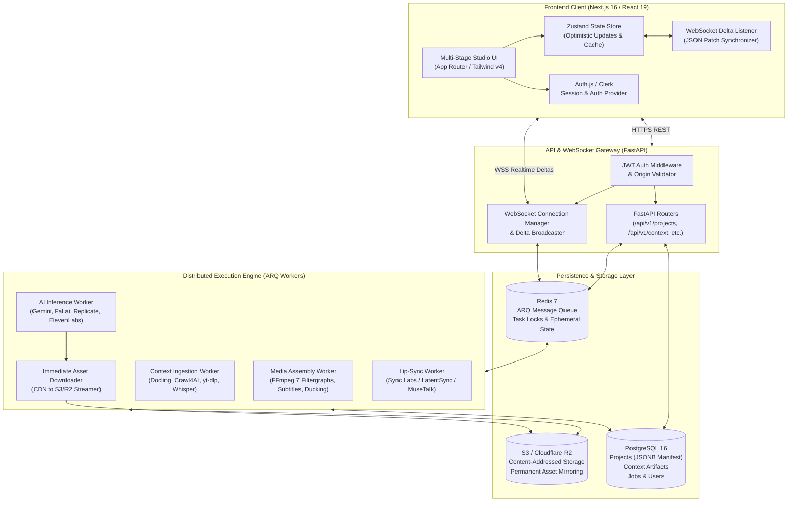

# Master Architecture & Nano-Task Development Blueprint
## Merging AI-Content-Studio & ContentMachine into an Enterprise AI Video Engine

---

## 1. Executive Summary & System Architecture

### 1.1 Project Objective
Transform the disparate prototypes of **AI-Content-Studio** (Next.js 16 + FastAPI monorepo, timeline engine, clip intelligence) and **ContentMachine** (prompt engineering, 360° character turnaround sheets, multi-provider visual generation, 5-stage pipeline) into an enterprise-grade, fullstack AI video production platform. 

The core architectural pillar is the **Master JSON Manifest** stored in PostgreSQL (`JSONB`), acting as the immutable single source of truth across Next.js (App Router, Zustand, WebSocket deltas), FastAPI backend services, ARQ distributed background workers, external AI inference providers (Gemini, Replicate, Fal.ai, ElevenLabs, SyncLabs), and the local FFmpeg 7 media engine.

### 1.2 System Topology Diagram



### 1.3 Key Architectural Upgrades from Prototypes
1. **URL Expiration Mitigation**: Replicate and Fal.ai URLs expire within hours. Every completed asset is immediately streamed by the worker directly into S3/Cloudflare R2, and only the permanent S3/CDN URL is written to the Master JSON before notifying the client.
2. **PostgreSQL JSONB with Versioning**: Replaces local `project.json` and SQLite checkpointing with transactional PostgreSQL `JSONB` columns, optimistic locking with monotonic revision counters (`version: 14`), and sub-tree patch updates via `jsonb_set`.
3. **Zustand WebSocket Sync via JSON Patch (RFC 6902)**: Instead of re-broadcasting multi-megabyte project manifests over WebSockets upon every progress tick, workers emit RFC 6902 JSON patch deltas (e.g. `[{"op": "replace", "path": "/scenes/0/keyframe/status", "value": "completed"}]`).
4. **NotebookLM-Style Content-Addressed Context Ingestion**: Raw reference materials (PDFs, URLs, YouTube videos) are hashed via SHA-256 upon upload. Decoded markdown, transcripts, and visual breakdowns are cached in `context_artifacts`. Script iterations query pre-processed artifacts rather than reprocessing raw inputs.
5. **Deterministic Media Synchronization**: Elimination of PTS/DTS audio drift through forced `-c:a aac -avoid_negative_ts make_zero` FFmpeg filter chains, precise `adelay`/`amix` multi-track scene composition, and dynamic EBU R128 loudness normalization (`loudnorm=I=-16:TP=-1.5:LRA=11`).

---

## 2. Master JSON Manifest Specification

The schema below is standardized across TypeScript (`web/src/types/manifest.ts`) using Zod and Python (`server/schemas/manifest.py`) using Pydantic v2.

```typescript
export type AssetStatus = 'idle' | 'queued' | 'generating' | 'completed' | 'failed';

export interface CharacterConsistency {
  id: string; // e.g. "char_01"
  name: string;
  role: 'protagonist' | 'antagonist' | 'supporting' | 'narrator';
  description: string;
  prompt360: string;
  negativePrompt?: string;
  status: AssetStatus;
  progressPercent: number;
  error?: string | null;
  selectedAssetUrl: string | null; // Permanent R2/S3 URL
  variants: string[];
}

export interface ObjectConsistency {
  id: string; // e.g. "obj_01"
  name: string;
  category: 'prop' | 'vehicle' | 'costume' | 'environment';
  prompt360: string;
  status: AssetStatus;
  progressPercent: number;
  error?: string | null;
  selectedAssetUrl: string | null;
  variants: string[];
}

export interface DialogueLine {
  id: string; // e.g. "dlg_01_01"
  speakerId: string; // References CharacterConsistency.id
  voiceId: string;
  voiceProvider: 'elevenlabs' | 'google_tts' | 'azure';
  startOffsetSec: number;
  endOffsetSec: number;
  text: string;
  assetUrl: string | null;
  status: AssetStatus;
}

export interface SceneAudio {
  voiceover: {
    enabled: boolean;
    startOffsetSec: number;
    endOffsetSec: number;
    provider: 'elevenlabs' | 'google_tts';
    voiceId: string;
    text: string;
    assetUrl: string | null;
    status: AssetStatus;
  };
  dialogue: DialogueLine[];
  sfx: {
    mode: 'stock' | 'generative' | 'none';
    prompt: string;
    assetUrl: string | null;
    status: AssetStatus;
  };
  mergedSceneAudioUrl: string | null;
  status: AssetStatus;
}

export interface SceneKeyframe {
  refIds: string[]; // e.g. ["char_01", "obj_01"]
  prompt: string;
  negativePrompt?: string;
  aspectRatio: '16:9' | '9:16' | '1:1';
  status: AssetStatus;
  progressPercent: number;
  selectedAssetUrl: string | null;
  variants: string[];
}

export interface SceneVideo {
  model: 'kling_v3' | 'ltx_2_pro' | 'minimax_hailuo' | 'runway_gen3' | 'veo_2';
  supportsNativeAudio: boolean;
  requiresLipSync: boolean;
  motionPrompt: string;
  cameraMotion?: string;
  rawVideoUrl: string | null;
  lipSyncedVideoUrl: string | null;
  status: AssetStatus;
  progressPercent: number;
  error?: string | null;
}

export interface SceneNode {
  sceneNumber: number;
  id: string; // e.g. "scene_01"
  timestamp: {
    startSec: number;
    endSec: number;
  };
  visualDescription: string;
  camera: {
    angle: string;
    movement: string;
    lens: string;
  };
  keyframe: SceneKeyframe;
  audio: SceneAudio;
  video: SceneVideo;
}

export interface MasterManifest {
  projectId: string;
  version: number; // Incremented on every mutation for optimistic locking
  title: string;
  format: 'cinematic_drama' | 'documentary' | 'explainer' | 'podcast_clip' | 'vertical_short';
  contextArtifactIds: string[]; // References ContextArtifact.id
  globalStyle: {
    aspectRatio: '16:9' | '9:16' | '1:1';
    resolution: '1080p' | '4k';
    visualStylePrompt: string;
    colorGradingPreset: string;
    musicGenrePrompt?: string;
  };
  consistencies: {
    characters: CharacterConsistency[];
    objects: ObjectConsistency[];
  };
  scenes: SceneNode[];
  outroEndFrame: {
    prompt: string;
    selectedAssetUrl: string | null;
    variants: string[];
    status: AssetStatus;
  };
  assembly: {
    transitionType: 'cut' | 'crossfade' | 'dip_to_black';
    transitionDurationSec: number;
    backgroundMusicUrl: string | null;
    burnCaptions: boolean;
    subtitleStyle: 'subtitles_classic' | 'karaoke_active_word' | 'minimal_lower_third';
    thumbnail: {
      prompt: string;
      selectedAssetUrl: string | null;
      variants: string[];
      status: AssetStatus;
    };
    finalVideoUrl: string | null;
    bundleZipUrl: string | null;
    status: AssetStatus;
    progressPercent: number;
  };
}
```

---

## 3. Comprehensive Nano-Task Breakdown

### Phase 0: Monorepo Foundation, Containerization & Tooling Setup

#### `TASK-0.1`: Monorepo Directory Topology & Workspaces Configuration
- **Files**: `package.json`, `pnpm-workspace.yaml`, `pyproject.toml`, `.gitignore`, `.editorconfig`
- **Actions**:
  1. Configure root `pnpm-workspace.yaml` including packages `web` and `shared-types`.
  2. Configure root Python environment using `uv` with Python 3.12 workspace roots: `server/` and `workers/`.
  3. Create shared directory structure:
     - `/web` (Next.js 16 app)
     - `/server` (FastAPI API server)
     - `/workers` (ARQ background tasks)
     - `/shared/schemas` (JSON Schema export definitions)
     - `/infra/docker` (Dockerfiles, Docker Compose, Nginx, MinIO scripts)
- **Acceptance Criteria**: `pnpm -r install` runs without workspace errors; `uv pip install -e ./server` resolves dependencies.

#### `TASK-0.2`: Local Infrastructure Docker Compose Stack
- **Files**: `infra/docker/docker-compose.yml`, `infra/docker/minio-init.sh`, `infra/docker/nginx.conf`
- **Actions**:
  1. Define PostgreSQL 16 Alpine container with healthchecks and persistent volume mount.
  2. Define Redis 7.2 Alpine container configured with AOF persistence enabled.
  3. Define MinIO S3-compatible object storage container with bucket auto-provisioning script (`minio-init.sh` creates `studio-assets` bucket and public-read policy).
  4. Define Nginx reverse proxy mapping `/` to Next.js (port 3000), `/api` to FastAPI (port 8008), `/ws` to WebSocket gateway, and `/storage` to MinIO (port 9000).
- **Verification**: Run `docker compose up -d`; `curl -f http://localhost:8008/health` returns 200, PostgreSQL accepts `psql` connections, MinIO web console accessible on port 9001.

#### `TASK-0.3`: Environment Configuration & Validation Harness
- **Files**: `.env.example`, `server/core/config.py`, `web/src/lib/env.ts`
- **Actions**:
  1. Create exhaustive `.env.example` defining database URLs, Redis URLs, S3/R2 credentials, JWT secret keys, and provider API keys (`GEMINI_API_KEY`, `ANTHROPIC_API_KEY`, `REPLICATE_API_TOKEN`, `FAL_KEY`, `ELEVENLABS_API_KEY`, `SYNCLABS_API_KEY`).
  2. Implement Pydantic `BaseSettings` class in `server/core/config.py` with strict type validation, masking helper for logged keys, and automated detection of missing keys.
  3. Implement Zod-based `env.ts` in Next.js ensuring build-time validation of public and server runtime variables.
- **Verification**: Unit tests verifying that server fails to boot if `DATABASE_URL` is malformed and successfully masks secrets in `/api/config`.

---

### Phase 1: Database Architecture, Storage Mirroring & Schema Validation

#### `TASK-1.1`: PostgreSQL Database Connection & SQLAlchemy 2.0 Async Session
- **Files**: `server/core/database.py`, `server/models/base.py`
- **Actions**:
  1. Setup Async SQLAlchemy engine using `asyncpg` driver (`postgresql+asyncpg://...`).
  2. Configure connection pool with `pool_size=20`, `max_overflow=10`, `pool_recycle=1800`, and `pool_pre_ping=True`.
  3. Implement async session dependency `get_db_session()` for FastAPI router injection with automated rollback on unhandled exceptions.
- **Verification**: Unit test establishing concurrent session checkout and executing `SELECT 1`.

#### `TASK-1.2`: Core Relational Entities & JSONB Manifest Model
- **Files**: `server/models/project.py`, `server/models/context_artifact.py`, `server/models/job.py`, `server/models/user.py`
- **Actions**:
  1. Create `User` model: `id` (UUIDv4), `email`, `hashed_password`, `name`, `created_at`, `updated_at`.
  2. Create `Project` model:
     - `id` (String primary key, e.g. `proj_XXXXXXXX`)
     - `user_id` (ForeignKey to `User.id`, indexed)
     - `title` (String)
     - `format` (String)
     - `version` (Integer, default 1, incremented on update)
     - `manifest` (`JSONB`, nullable=False, containing full `MasterManifest`)
     - `status` (String enum: `draft`, `generating`, `completed`, `error`)
     - `created_at`, `updated_at` (Timestamps with timezone)
  3. Create `ContextArtifact` model:
     - `id` (String, e.g. `ctx_XXXXXXXX`)
     - `project_id` (ForeignKey to `Project.id`)
     - `content_hash` (String(64), SHA-256 of raw input, indexed)
     - `source_type` (Enum: `pdf`, `docx`, `pptx`, `html`, `url`, `video`, `audio`)
     - `original_filename` (String)
     - `storage_path` (String, S3 key)
     - `extracted_markdown` (Text)
     - `summary_json` (`JSONB`, visual style, entities, themes)
     - `created_at` (Timestamp)
  4. Create `JobQueueRecord` model:
     - `id` (UUIDv4)
     - `project_id` (ForeignKey to `Project.id`)
     - `stage` (Enum: `planner`, `consistencies`, `keyframes`, `audio`, `video`, `assembly`)
     - `target_id` (String, e.g. `char_01` or `scene_03`)
     - `arq_job_id` (String, indexed)
     - `status` (Enum: `queued`, `running`, `completed`, `failed`, `cancelled`)
     - `retry_count` (Integer, default 0)
     - `error_message` (Text, nullable=True)
- **Verification**: Run `pytest tests/test_models.py` verifying all constraints, cascade deletes, and JSONB queries.

#### `TASK-1.3`: Alembic Migration Setup & Initial Migration Script
- **Files**: `server/alembic.ini`, `server/alembic/env.py`, `server/alembic/versions/001_initial_schema.py`
- **Actions**:
  1. Initialize Alembic with async driver support in `env.py`.
  2. Generate first revision script covering `users`, `projects`, `context_artifacts`, and `job_queue_records`.
  3. Add GIN indexes on `projects.manifest` (`CREATE INDEX idx_projects_manifest_gin ON projects USING gin(manifest);`) for sub-path JSON queries.
- **Verification**: Execute `alembic upgrade head`; inspect database schema with `psql \d+ projects`.

#### `TASK-1.4`: Dual-Language Schema Synchronizer (Pydantic v2 & Zod)
- **Files**: `server/schemas/manifest.py`, `web/src/types/manifest.ts`, `scripts/sync_schemas.py`
- **Actions**:
  1. Write complete Pydantic v2 model hierarchy in `server/schemas/manifest.py` matching Section 2 specification with field validators (e.g. validating timestamps `startSec < endSec`, validating that references in `refIds` exist in `consistencies`).
  2. Implement `scripts/sync_schemas.py` that outputs the JSON Schema from Pydantic and generates TypeScript Zod definitions into `web/src/types/manifest.ts` via `json-schema-to-zod`.
- **Verification**: Run `python scripts/sync_schemas.py`; ensure `pnpm --filter web type-check` compiles with zero discrepancies.

#### `TASK-1.5`: Enterprise Asset Downloader & S3/R2 Storage Service
- **Files**: `server/core/storage.py`, `tests/test_storage.py`
- **Actions**:
  1. Implement `StorageService` class supporting both AWS S3 and Cloudflare R2 using `aioboto3`.
  2. Implement streaming asset downloader `download_and_persist_asset(remote_url: str, project_id: str, subfolder: str, extension: str) -> str`:
     - Streams bytes directly from remote provider CDN into S3/R2 object storage without buffering multi-gigabyte files into server RAM.
     - Computes SHA-256 hash during upload to construct deterministic keys: `/{project_id}/{subfolder}/{hash}.{ext}`.
     - Sets `ContentType` and `CacheControl="public, max-age=31536000, immutable"`.
     - Returns the public CDN / MinIO URL.
  3. Implement error handling for 403/404 CDN expiration with retry policies.
- **Verification**: Run test script downloading a 50MB video from an external endpoint, persisting it to MinIO, and verifying byte integrity via SHA-256 match.

---

### Phase 2: Authentication, Security & Project Authorization

#### `TASK-2.1`: FastAPI Security Core & JWT Authentication Provider
- **Files**: `server/core/security.py`, `server/routers/auth.py`
- **Actions**:
  1. Implement password hashing using `bcrypt` (work factor 12).
  2. Implement JWT token minting (`access_token` with 60-min expiration, `refresh_token` with 30-day expiration).
  3. Implement `get_current_user` FastAPI dependency extracting token from `Authorization: Bearer <token>` header or `studio_session` HTTP-only cookie.
  4. Implement `/api/v1/auth/register`, `/api/v1/auth/login`, `/api/v1/auth/refresh`, and `/api/v1/auth/logout`.
- **Verification**: Integration test registering a user, logging in, receiving valid JWT, accessing protected route, and rejecting invalid tokens.

#### `TASK-2.2`: Frontend Authentication Flow (Auth.js / NextAuth v5)
- **Files**: `web/src/auth.ts`, `web/src/middleware.ts`, `web/src/app/login/page.tsx`, `web/src/app/register/page.tsx`
- **Actions**:
  1. Configure Auth.js (v5) with Credentials Provider forwarding auth requests to FastAPI backend.
  2. Store backend JWT in encrypted NextAuth session token.
  3. Create Edge Middleware (`middleware.ts`) protecting `/studio/:path*` and `/api/proxy/:path*`, redirecting unauthenticated users to `/login`.
  4. Create polished login and registration pages with form validation (React Hook Form + Zod) and error callouts.
- **Verification**: Browser automation test verifying redirection on `/studio`, successful sign-in, and session persistence across page reloads.

#### `TASK-2.3`: Project Multi-Tenancy & Row-Level Authorization Guards
- **Files**: `server/core/permissions.py`, `server/routers/projects.py`
- **Actions**:
  1. Implement permission dependency `verify_project_ownership(project_id: str, user: User, db: AsyncSession) -> Project`:
     - Queries `Project` by ID; raises 404 if not found.
     - Verifies `project.user_id == user.id`; raises 403 Forbidden if mismatched.
  2. Implement CRUD endpoints in `server/routers/projects.py`:
     - `POST /api/v1/projects` (creates empty project manifest with unique ID)
     - `GET /api/v1/projects` (lists user's projects with pagination, format, and thumbnail)
     - `GET /api/v1/projects/{id}` (returns complete Master JSON manifest)
     - `PATCH /api/v1/projects/{id}` (applies partial JSON update with version increment)
     - `DELETE /api/v1/projects/{id}` (cascades deletion across DB, S3 assets, and active jobs)
- **Verification**: Execute test where User A attempts to read or mutate User B's project ID, asserting HTTP 403 response.

---

### Phase 3: NotebookLM-Style Multimodal Ingestion Engine

#### `TASK-3.1`: Content-Addressed File Ingestion Pipeline & SHA-256 Hashing
- **Files**: `server/core/ingestion/hasher.py`, `server/routers/context.py`
- **Actions**:
  1. Implement streaming SHA-256 hasher in `hasher.py` calculating checksum as bytes enter the server.
  2. Implement `POST /api/v1/projects/{id}/context/upload`:
     - Computes hash.
     - Checks `context_artifacts` table for existing `content_hash`.
     - If hash exists, reuses existing record and links `contextArtifactIds` into project manifest without re-parsing.
     - If new, saves raw file to S3 (`/{project_id}/raw_context/{hash}.{ext}`) and dispatches `process_context_artifact` ARQ background task.
- **Verification**: Upload the same 10MB PDF twice; assert that second upload returns within 10ms with cached artifact ID.

#### `TASK-3.2`: Document Parser Integration (IBM Docling & MarkItDown)
- **Files**: `server/core/ingestion/doc_parser.py`, `tests/test_doc_parser.py`
- **Actions**:
  1. Implement `DocumentParser` using IBM `docling` with fallback to Microsoft `markitdown`.
  2. Support PDF, DOCX, PPTX, and HTML formats.
  3. Extract clean Markdown text, preserve table structures in GitHub Flavored Markdown, and isolate embedded figures/charts.
  4. Save extracted markdown into `context_artifacts.extracted_markdown`.
- **Verification**: Process a multi-column sample PDF with embedded tables; verify extracted markdown retains table columns and heading hierarchy.

#### `TASK-3.3`: Web URL Scraper via Crawl4AI
- **Files**: `server/core/ingestion/web_crawler.py`
- **Actions**:
  1. Integrate `crawl4ai` asynchronous web crawler.
  2. Strip navigation headers, cookie banners, tracking scripts, and advertisements.
  3. Extract core article text, publication timestamp, author, and primary media elements into structured markdown.
  4. Implement SSRF prevention: reject private IP ranges (10.0.0.0/8, 192.168.0.0/16, 127.0.0.0/8, 169.254.0.0/16) and localhost endpoints.
- **Verification**: Trigger crawl of a public news article; assert clean Markdown output and verify rejection of `http://127.0.0.1:8008`.

#### `TASK-3.4`: Video & Audio Ingestion (`yt-dlp` + FFmpeg Scene Detector + Faster-Whisper)
- **Files**: `server/core/ingestion/media_ingester.py`
- **Actions**:
  1. Implement `yt-dlp` wrapper to download audio and video streams up to 1080p from YouTube or direct MP4/MP3 URLs.
  2. Run FFmpeg scene-change detection filtergraph:
     ```bash
     ffmpeg -i input.mp4 -filter_complex "select='gt(scene,0.3)',metadata=print:file=scene_cuts.txt" -vsync vfr keyframe_%03d.png
     ```
  3. Transcribe audio using `faster-whisper` (large-v3 model with CPU/CUDA INT8 quantization), emitting word-level timestamps:
     ```python
     segments, info = whisper_model.transcribe(audio_path, word_timestamps=True)
     ```
  4. Save keyframe images to S3 and combine transcript + timestamps into `context_artifacts.extracted_markdown`.
- **Verification**: Process a 60-second video clip; verify generated keyframe images correspond to scene transitions and transcript words contain `start` and `end` offsets.

#### `TASK-3.5`: Multimodal LLM Context Summarizer (Gemini Flash Pass)
- **Files**: `server/core/ingestion/summarizer.py`
- **Actions**:
  1. Implement single-pass Gemini 1.5/2.0 Flash prompt ingesting the extracted markdown, transcript, and keyframe image bytes.
  2. Direct the model to produce a structured JSON context summary (`summary_json`):
     - `core_narrative`: Summary of topic/facts.
     - `visual_style`: Lighting, color palette, camera conventions observed.
     - `key_entities`: Notable characters, historical figures, vehicles, props.
     - `pacing`: Cadence, music style, emotional arc.
  3. Persist `summary_json` into database.
- **Verification**: Inspect generated `summary_json` for a sample reference video; assert non-null fields for visual style and entities.

#### `TASK-3.6`: Multimodal Ingestion UI & Context Shelf Drawer
- **Files**: `web/src/components/context/ContextShelf.tsx`, `web/src/components/context/UploadDropzone.tsx`, `web/src/components/context/ArtifactViewerModal.tsx`
- **Actions**:
  1. Build slide-over Context Shelf drawer in Next.js allowing drag-and-drop of documents, URLs, and video links.
  2. Display upload progress bar, SHA-256 hashing indicator, and status badge (`parsing` -> `summarizing` -> `ready`).
  3. Create modal showing parsed markdown preview, detected entities, and visual style notes.
- **Verification**: Upload a document via the UI; observe real-time status change to `ready` and view summary cards.

---

### Phase 4: Async Job Queue, Worker Topology & Real-Time WebSocket Infrastructure

#### `TASK-4.1`: Redis & ARQ Worker Architecture Setup
- **Files**: `workers/worker.py`, `workers/config.py`, `server/core/queue.py`
- **Actions**:
  1. Configure ARQ worker settings with Redis connection pool (`max_connections=50`), job timeout of 600s, and graceful shutdown handling (`SIGTERM`/`SIGINT`).
  2. Implement global queue manager in `server/core/queue.py` wrapping `arq.create_pool` with typed helper functions:
     - `enqueue_planner_task(project_id, ...)`
     - `enqueue_consistency_batch(project_id, ...)`
     - `enqueue_keyframe_batch(project_id, ...)`
     - `enqueue_audio_merge(project_id, scene_id, ...)`
     - `enqueue_video_generation(project_id, scene_id, ...)`
     - `enqueue_timeline_assembly(project_id, ...)`
  3. Implement rate-limiting semaphores per external provider in `workers/worker.py` (e.g. `asyncio.Semaphore(5)` for Replicate/Fal.ai) to prevent HTTP 429 errors.
- **Verification**: Run `python -m arq workers.worker.WorkerSettings`; test dispatching and consuming 20 mock tasks concurrently.

#### `TASK-4.2`: Job Lifecycle, State Machine & Manifest Updater
- **Files**: `workers/utils/manifest_updater.py`, `server/models/job.py`
- **Actions**:
  1. Implement atomic manifest updater `update_manifest_node(project_id: str, path: str, value: Any, db: AsyncSession)`:
     - Uses PostgreSQL `jsonb_set` for atomic in-place updates.
     - Increments `project.version` by 1.
     - Emits change event to Redis Pub/Sub channel `channel:project:{project_id}`.
  2. Implement error interceptor: if a worker task throws an exception, catch it, set `status: "failed"` and `error: str(exc)` on the target node, update DB, and publish failure event.
- **Verification**: Concurrently update two different scenes from two separate workers; assert both changes persist without race conditions or overwriting.

#### `TASK-4.3`: WebSocket Connection Manager & Authentication Handshake
- **Files**: `server/core/websocket.py`, `server/routers/ws.py`
- **Actions**:
  1. Implement `ConnectionManager` class maintaining active WebSocket connections mapped by `project_id` and `user_id`.
  2. Implement WebSocket route `GET /ws/projects/{project_id}`:
     - Validates JWT token from query string `?token=...` or cookie.
     - Verifies user has access to `project_id`.
     - Subscribes connection to Redis Pub/Sub channel `channel:project:{project_id}`.
     - Implements ping/pong heartbeat (every 30 seconds) to prevent stale connection drops.
- **Verification**: Connect via WebSocket client (`wscat`); send ping and verify pong; publish test message to Redis and verify delivery to client.

#### `TASK-4.4`: JSON Patch (RFC 6902) Delta Engine & Broadcast Worker
- **Files**: `server/core/patch_engine.py`, `web/src/lib/patch.ts`
- **Actions**:
  1. Build delta generator that formats state transitions into RFC 6902 JSON Patch arrays:
     ```json
     [
       { "op": "replace", "path": "/scenes/2/video/status", "value": "generating" },
       { "op": "replace", "path": "/scenes/2/video/progressPercent", "value": 45 }
     ]
     ```
  2. Write client-side patch applicator in `web/src/lib/patch.ts` using `fast-json-patch` or Immer to apply updates directly into the Zustand project store.
- **Verification**: Benchmark payload size: compare full 1.2MB manifest broadcast against a 120-byte patch delta during high-frequency generation updates.

---

### Phase 5: AI Provider Adapters & Prompt Engineering Engine

#### `TASK-5.1`: Provider Adapter Core & HTTP Client Resiliency
- **Files**: `server/providers/base.py`, `server/providers/http_client.py`
- **Actions**:
  1. Implement base abstract classes: `LLMProvider`, `ImageGenProvider`, `VideoGenProvider`, `TTSProvider`, `LipSyncProvider`.
  2. Implement unified HTTP client with `httpx.AsyncClient`:
     - Configured with connection pooling and HTTP/2 support.
     - Exponential backoff with jitter on HTTP 429 (Rate Limit) and 503 (Overloaded):
       ```python
       wait_time = min(max_delay, initial_delay * (backoff_factor ** attempt) + random.uniform(0, 1))
       ```
     - Automatic parsing of provider retry headers (`Retry-After`).
- **Verification**: Mock 429 response from API; verify client backs off and retries up to configured limit before raising exception.

#### `TASK-5.2`: LLM Engine (Gemini & Claude with Structured Output Enforcement)
- **Files**: `server/providers/llm.py`, `server/prompts/story_prompts.py`
- **Actions**:
  1. Implement Gemini 1.5/2.0 Pro adapter using `google-genai` SDK with `response_schema` enforcing JSON schema output.
  2. Implement Claude 3.5 Sonnet adapter using direct Anthropic API / Fal.ai with tool-calling schema enforcement.
  3. Transplant and refine `ContentMachine`'s 300+ line documentary prompt engine:
     - Historical veracity, narrative hook formulas, visual pacing markers.
     - Turnaround specification rules (neutral lighting, 360° front/profile/back poses).
     - Camera directive vocabulary (low-angle dolly, anamorphic flare, wide establishing).
- **Verification**: Generate a 5-scene documentary script; assert output strictly parses into Pydantic `SceneNode` array without missing keys.

#### `TASK-5.3`: Visual Image Generation Adapter (Fal.ai, Replicate, Imagen 3)
- **Files**: `server/providers/image.py`
- **Actions**:
  1. Implement Fal.ai Flux Pro/Dev adapter with reference image support (`image_prompt_strength` / `controlnet`).
  2. Implement Replicate Flux / SDXL adapter with polling and webhook support.
  3. Implement Gemini Imagen 3 adapter.
  4. Build reference image injection helper: takes locked character turnaround URLs and object URLs and injects them into provider payloads as IP-Adapter or image-to-image conditioning.
- **Verification**: Execute test image generation passing a character reference URL; verify generated image returns valid CDN URL and downloads successfully.

#### `TASK-5.4`: Video Generation Adapter (Kling, LTX-Video, Minimax, Runway)
- **Files**: `server/providers/video.py`
- **Actions**:
  1. Implement Kling v1.5/v3 adapter supporting start-frame and end-frame conditioning (`start_image_url`, `end_image_url`).
  2. Implement Lightricks LTX-Video adapter via Fal.ai.
  3. Implement Minimax Hailuo and Runway Gen-3 adapters via Replicate.
  4. Parse provider capabilities: set `supportsNativeAudio: true` for LTX-2 / Kling v3 where applicable, otherwise `false`.
- **Verification**: Dispatch image-to-video request using a start keyframe; verify polling retrieves final video URL.

#### `TASK-5.5`: Audio & Voice Synthesis Adapter (ElevenLabs & Google Cloud TTS)
- **Files**: `server/providers/audio.py`
- **Actions**:
  1. Implement ElevenLabs adapter supporting voice cloning, voice settings (`stability`, `similarity_boost`, `style`), and character voice ID assignment.
  2. Implement Google Cloud TTS adapter as resilient high-throughput fallback.
  3. Implement word-level timestamp alignment extraction from ElevenLabs `/v1/text-to-speech/{voice_id}/with-timestamps`.
- **Verification**: Synthesize test dialogue string; verify MP3 audio buffer is returned alongside valid character-level/word-level timing offsets.

#### `TASK-5.6`: Conditional Lip-Sync Adapter (Sync Labs, LatentSync, MuseTalk)
- **Files**: `server/providers/lipsync.py`
- **Actions**:
  1. Implement Sync Labs API client: sends input video URL + input audio URL to `/v2/generate`.
  2. Implement fallback to self-hosted LatentSync / MuseTalk worker endpoint.
  3. Expose execution method `apply_lip_sync(video_url: str, audio_url: str) -> str`:
     - Dispatches job.
     - Polls status until completed.
     - Streams output MP4 to S3 storage and returns permanent URL.
- **Verification**: Submit 5-second talking head clip and audio track; verify returned video audio is lip-synced and duration matches audio duration.

---

### Phase 6: The 7-Stage Generation Pipeline Implementation

#### `TASK-6.1`: Stage 1 — Planner Section & Story Pitch Generator
- **Files**: `server/pipeline/stage1_planner.py`, `tests/test_stage1.py`
- **Actions**:
  1. Implement `generate_story_pitches(project_id: str, prompt: str, format: str) -> List[StoryPitch]`:
     - Reads `context_artifacts` summary JSON if available.
     - Prompts LLM to produce 3 distinct conceptual angles (e.g. dramatic, investigative, chronological).
  2. Implement `select_pitch_and_expand_manifest(project_id: str, pitch_index: int)`:
     - Expands chosen pitch into full `MasterManifest` scenes, characters, and camera descriptions.
     - Populates all scene nodes with `status: "idle"`.
     - Writes manifest to PostgreSQL JSONB column.
     - Emits WebSocket broadcast populating Next.js empty-state cards.
- **Verification**: Trigger Stage 1 via API; verify PostgreSQL `manifest` contains populated scenes with `idle` status and proper start/end timestamps.

#### `TASK-6.2`: Stage 2 — Characters & Objects Batch Engine with Turnarounds
- **Files**: `server/pipeline/stage2_consistencies.py`
- **Actions**:
  1. Read `consistencies.characters` and `consistencies.objects` from manifest.
  2. Format-aware routing: if `format == "podcast_clip"`, generate single host portrait; if `cinematic_drama`, append 360° turnaround suffix:
     `", 360-degree character turnaround sheet, front view, side profile, back view, neutral studio lighting, cinematic hyper-detailed"`.
  3. Dispatch all character and object generations in parallel using ARQ tasks with `asyncio.Semaphore(5)`.
  4. For each asset, generate 4 candidate variants.
  5. As each item completes, download to S3 (`/{project_id}/chars/{id}_v{i}.png`), set `selectedAssetUrl = variants[0]`, update manifest node to `completed`, and emit WebSocket patch.
- **Verification**: Run Stage 2 on a project with 2 characters and 2 objects; verify 16 total variants generated and persisted to S3; observe WebSocket deltas.

#### `TASK-6.3`: Stage 3 — Keyframes with Reference Injection & Frame Chaining
- **Files**: `server/pipeline/stage3_keyframes.py`
- **Actions**:
  1. For each scene in `manifest.scenes`, resolve `keyframe.refIds`:
     - Look up locked `selectedAssetUrl` from characters/objects generated in Stage 2.
     - Inject URLs into prompt payload for image model IP-Adapter.
  2. Implement Start-to-End Frame Chaining:
     - Scene $N$ Keyframe prompt anchors the start of Scene $N$.
     - Scene $N+1$ Keyframe anchors the start of Scene $N+1$ AND the end of Scene $N$.
     - For the final scene, generate `manifest.outroEndFrame` to anchor the closing shot.
  3. Dispatch keyframe generation batch across all scenes.
  4. Stream results to S3, set `selectedAssetUrl`, update node to `completed`, and notify client.
- **Verification**: Check keyframe prompts and references for Scene 2; confirm it includes image reference URLs from characters chosen in Stage 2.

#### `TASK-6.4`: Stage 4 — Multi-Track Audio Synthesis & Per-Scene FFmpeg Mix
- **Files**: `server/pipeline/stage4_audio.py`, `server/core/media/audio_mixer.py`
- **Actions**:
  1. Batch-synthesize all voiceover clips and dialogue lines in parallel via ElevenLabs.
  2. Download raw audio clips to S3.
  3. Implement per-scene FFmpeg filtergraph mixer in `audio_mixer.py`:
     - Reads `startOffsetSec` and `endOffsetSec` for voiceover and dialogue lines.
     - Builds filtergraph with `adelay`, `apad`, `amix`, and `loudnorm`:
       ```bash
       ffmpeg -i vo.mp3 -i dlg1.mp3 -filter_complex \
         "[0:a]adelay=0|0,apad=whole_dur={dur_ms}[vo]; \
          [1:a]adelay={dlg_offset_ms}|{dlg_offset_ms},apad=whole_dur={dur_ms}[dlg]; \
          [vo][dlg]amix=inputs=2:duration=longest:normalize=0,loudnorm=I=-16:TP=-1.5:LRA=11[out]" \
         -map "[out]" -c:a aac -b:a 192k scene_master.m4a
       ```
  4. Persist `scene_master.m4a` to S3 and write `mergedSceneAudioUrl` to manifest.
- **Verification**: Run audio mix on a scene with overlapping VO and dialogue; verify resulting M4A audio file has exact duration matching `scene.timestamp.endSec - scene.timestamp.startSec`.

#### `TASK-6.5`: Stage 5 — Visual Video Generation & Conditional Lip-Sync Routing
- **Files**: `server/pipeline/stage5_video.py`
- **Actions**:
  1. For Scene $N$, construct video generation payload:
     - `start_image_url`: `scenes[N].keyframe.selectedAssetUrl`
     - `end_image_url`: `scenes[N+1].keyframe.selectedAssetUrl` (or `outroEndFrame.selectedAssetUrl` for final scene)
     - `duration`: `scenes[N].timestamp.endSec - scenes[N].timestamp.startSec`
     - `motion_prompt`: `scenes[N].video.motionPrompt`
  2. Dispatch generation to configured provider (Kling / LTX-Video).
  3. Stream generated video to S3 and set `rawVideoUrl`.
  4. Check routing condition:
     - If `video.supportsNativeAudio == False` and `video.requiresLipSync == True`:
       Enqueue Lip-Sync task combining `rawVideoUrl` + `audio.mergedSceneAudioUrl`.
       Save output to `lipSyncedVideoUrl`.
     - Else: set `lipSyncedVideoUrl = rawVideoUrl`.
  5. Update manifest node status to `completed`.
- **Verification**: Run Stage 5 on a scene requiring lip-sync; verify video generation triggers lip-sync worker, which updates `lipSyncedVideoUrl` and sets status to `completed`.

#### `TASK-6.6`: Stage 6 — Final Video Assembly, Subtitles & Thumbnail Variants
- **Files**: `server/pipeline/stage6_assembly.py`, `server/core/media/assembler.py`
- **Actions**:
  1. Collect all scene video clips (`lipSyncedVideoUrl ?? rawVideoUrl`) and audio tracks (`mergedSceneAudioUrl`).
  2. Create FFmpeg concat demuxer file with `-c:a aac -avoid_negative_ts make_zero` to guarantee zero PTS/DTS audio desynchronization.
  3. Mix background music track: apply automated sidechain ducking filter (`sidechaincompress`) reducing music volume by 12dB whenever voice audio is active.
  4. Burn subtitles if `manifest.assembly.burnCaptions == True`:
     - Generate `.ass` (Advanced SubStation Alpha) file from Whisper word timestamps with custom font styling and active-word karaoke highlights.
     - Burn using FFmpeg `subtitles=subs.ass` filter.
  5. Batch-generate 3-4 clickable thumbnail variants based on dramatic keyframes + prompt overlays.
  6. Upload final video to S3: `/{project_id}/exports/master_1080p.mp4`.
- **Verification**: Execute full assembly; inspect final MP4 in media player; verify audio stays in sync throughout transitions and ducking occurs during speech.

#### `TASK-6.7`: Stage 7 — Export Presets & Full Project ZIP Packager
- **Files**: `server/pipeline/stage7_export.py`
- **Actions**:
  1. Implement transcoding presets:
     - Web Master: H.264 / AAC MP4, 1080p, -14 LUFS (YouTube/Vimeo optimized).
     - Editing Master: Apple ProRes 422 HQ QuickTime MOV (for Premiere / DaVinci Resolve).
     - Vertical Social: 9:16 smart crop with centered subject tracking for TikTok / Shorts.
  2. Implement Project ZIP Exporter:
     - Streams all assets into a compressed ZIP file using `zipfile` / async stream:
       - `project.json` (raw Master JSON manifest)
       - `/characters/*.png`
       - `/keyframes/*.png`
       - `/audio/*.m4a`
       - `/subtitles.srt` and `/subtitles.ass`
       - `/scenes/*.mp4`
       - `/final_master.mp4`
     - Saves ZIP to S3 and provides download URL.
- **Verification**: Trigger ZIP export; download resulting archive; unpack and verify all media files and `project.json` are present and uncorrupted.

---

### Phase 7: Frontend Application, Zustand State Architecture & UI/UX

#### `TASK-7.1`: Zustand Studio Store with WebSocket Delta Synchronization
- **Files**: `web/src/store/studioStore.ts`, `web/src/hooks/useProjectSocket.ts`
- **Actions**:
  1. Implement `useStudioStore` in Zustand:
     - State: `manifest`, `activeStage`, `selectedSceneId`, `isGenerating`, `connectionState`.
     - Actions: `setManifest`, `applyPatchDelta`, `updatePrompt`, `selectVariant`, `retryNode`.
  2. Implement `useProjectSocket(projectId)` React hook:
     - Establishes WebSocket connection to `/ws/projects/{projectId}`.
     - Handles reconnect with exponential backoff on connection drop.
     - Parses incoming RFC 6902 JSON Patch messages and calls `applyPatchDelta`.
     - Triggers full manifest refetch if sequence gap detected.
- **Verification**: Mock WebSocket patch stream; verify Zustand store updates specific scene properties without full component tree re-rendering.

#### `TASK-7.2`: Empty-State Card Template System with Status Transitions
- **Files**: `web/src/components/studio/cards/GenerationCard.tsx`, `web/src/components/studio/cards/VariantPicker.tsx`
- **Actions**:
  1. Implement generic `GenerationCard` component supporting states:
     - `idle`: Render dashed skeleton card with editable prompt textarea and "Generate" button.
     - `queued`: Render pulse badge with queue position indicator.
     - `generating`: Render animated progress bar, elapsed time counter, and live status message.
     - `completed`: Render media preview (image/video/waveform), variant thumbnail row, regenerate button, and full-screen modal trigger.
     - `failed`: Render error callout with retry button.
  2. Implement `VariantPicker` component allowing one-click selection of preferred output, updating `selectedAssetUrl` in manifest.
- **Verification**: Storybook / UI testing rendering `GenerationCard` across all five lifecycle states.

#### `TASK-7.3`: Stage 1 UI — Story Pitcher & Script Blueprint Editor
- **Files**: `web/src/app/studio/[projectId]/stage-1-planner/page.tsx`, `web/src/components/studio/planner/PitchCard.tsx`
- **Actions**:
  1. Create Stage 1 view featuring prompt input box, context artifact pills, and format selector dropdown.
  2. Display 3 generated story pitch cards with expandable outlines.
  3. Build interactive scene blueprint table allowing re-ordering, editing scene duration, camera angles, and dialogue lines before proceeding to Stage 2.
- **Verification**: Enter topic; receive 3 pitches; select Pitch 2; verify scenes populate in the blueprint table with editable fields.

#### `TASK-7.4`: Stage 2 UI — Characters & Objects 360° Turnaround Grid
- **Files**: `web/src/app/studio/[projectId]/stage-2-consistencies/page.tsx`, `web/src/components/studio/consistencies/TurnaroundViewer.tsx`
- **Actions**:
  1. Build grid displaying Character Cards and Object Cards.
  2. Provide "Generate All Consistencies" batch action button and per-card regenerate button.
  3. Build `TurnaroundViewer` modal: lets user click and inspect high-resolution 360° turnaround sheet or scrub across angles.
  4. Variant picker row on each card allowing selection of preferred character look.
- **Verification**: Batch generate characters; verify cards transition from `idle` -> `generating` -> `completed` with variant thumbnails.

#### `TASK-7.5`: Stage 3 UI — Reference-Injected Keyframe Timeline Grid
- **Files**: `web/src/app/studio/[projectId]/stage-3-keyframes/page.tsx`, `web/src/components/studio/keyframes/KeyframeCard.tsx`
- **Actions**:
  1. Build chronological keyframe cards indexed by scene number.
  2. Display linked character and object badge pills on each card (e.g. `[Elena]` `[Red Dress]`).
  3. Visual indicator displaying Start-to-End Frame Chaining connection arrows between Scene $N$ and Scene $N+1$.
  4. Individual keyframe prompt editor with instant regenerate trigger.
- **Verification**: Verify keyframe cards display character reference badges and chaining connectors.

#### `TASK-7.6`: Stage 4 UI — Multi-Track Audio Timeline & Waveform Player
- **Files**: `web/src/app/studio/[projectId]/stage-4-audio/page.tsx`, `web/src/components/studio/audio/WaveformPlayer.tsx`
- **Actions**:
  1. Create multi-track timeline visualizer: Voiceover track, Dialogue track, SFX track.
  2. Implement `WaveformPlayer` using Wavesurfer.js to visualize audio waveforms and allow scrubbing.
  3. Provide per-line dialogue script editor with voice selector dropdown and individual line regeneration.
  4. "Mix Scene Audio" button triggering backend FFmpeg audio merge.
- **Verification**: Play mixed scene audio; observe synchronized waveform scrubbing and voiceover playback.

#### `TASK-7.7`: Stage 5 UI — Scene Video Generation & Hover Preview Grid
- **Files**: `web/src/app/studio/[projectId]/stage-5-videos/page.tsx`, `web/src/components/studio/videos/VideoCard.tsx`
- **Actions**:
  1. Build scene video generation card grid with video resolution badge (1080p) and motion prompt editor.
  2. Hover-to-play video preview component with muted autoplay and loop.
  3. Lip-sync status badge showing when video is undergoing conditional lip-sync chaining.
  4. Full-screen Video Modal with frame-stepping controls and side-by-side comparison with start/end keyframes.
- **Verification**: Hover over completed video card; verify instant video playback and modal inspection.

#### `TASK-7.8`: Stage 6 & 7 UI — Assembly Timeline, Subtitle Styler & Export Suite
- **Files**: `web/src/app/studio/[projectId]/stage-6-assembly/page.tsx`, `web/src/app/studio/[projectId]/stage-7-export/page.tsx`
- **Actions**:
  1. Create master video player with interactive subtitle toggle and style picker (Classic, Karaoke Word Highlight, Lower Third).
  2. Background music track selector with volume slider and ducking sensitivity controls.
  3. Thumbnail selection carousel with 4 generated variants and custom prompt regenerate input.
  4. Export suite page: format presets (Web MP4, ProRes, Vertical 9:16), audio loudness meters, and "Download Complete Project ZIP" button.
- **Verification**: Trigger assembly render; play final video in browser player; click Download ZIP and confirm archive download.

---

### Phase 8: Partial Regeneration Engine, Resiliency & Hardening

#### `TASK-8.1`: Intelligent Dependency Invalidation Graph (Partial Regeneration)
- **Files**: `server/core/invalidation.py`, `tests/test_invalidation.py`
- **Actions**:
  1. Implement DAG (Directed Acyclic Graph) of pipeline dependencies:
     - Modifying `consistencies.characters[i]` invalidates downstream keyframes referencing `char_i`, which invalidates corresponding scene videos and final assembly, but leaves audio and unrelated scenes untouched.
     - Modifying `scenes[i].audio.dialogue` only invalidates `scenes[i].audio.mergedSceneAudioUrl`, `scenes[i].video` (if lip-sync enabled), and final assembly.
  2. Implement `invalidate_manifest_node(project_id: str, node_path: str)`:
     - Sets target and dependent nodes to `idle` in PostgreSQL.
     - Emits WebSocket updates flipping cards back to editable skeleton state.
- **Verification**: Regenerate Character 1 in a 5-scene completed project; verify only scenes referencing Character 1 are reset to `idle`, while audio and independent scenes remain `completed`.

#### `TASK-8.2`: Worker Process Crash Recovery & Orphan Task Reaper
- **Files**: `server/core/reaper.py`, `workers/worker.py`
- **Actions**:
  1. Implement heartbeat tracking for running ARQ worker tasks in Redis (`SETEX job:{id}:heartbeat 30 1`).
  2. Implement startup recovery scanner `recover_pending_tasks()`:
     - On backend boot, query `JobQueueRecord` for jobs stuck in `running` status without active Redis heartbeat.
     - Reset status to `failed` with error "Task interrupted by worker restart" or automatically requeue if `retry_count < 3`.
- **Verification**: Kill worker process via `kill -9` during active generation; start worker; verify orphaned task is detected and gracefully recovered.

#### `TASK-8.3`: Production Security Hardening & Rate Limiter Middleware
- **Files**: `server/core/security_middleware.py`, `web/src/middleware.ts`
- **Actions**:
  1. Implement IP-based and user-based sliding-window rate limiting in FastAPI using Redis (`max 100 requests/min` for API, `max 10 requests/min` for generation triggers).
  2. Enforce strict Content Security Policy (CSP) and CORS origin validation allowing only configured domain origins.
  3. Validate request payload sizes (max 500MB for media uploads, max 2MB for JSON payloads).
- **Verification**: Flood `/api/v1/projects` with 150 rapid requests; assert HTTP 429 Too Many Requests response after threshold.

---

### Phase 9: Testing Suite, Verification & Quality Assurance

#### `TASK-9.1`: Unit Testing Suite (Backend Models, Schemas & FFmpeg Filters)
- **Files**: `server/tests/unit/test_schemas.py`, `server/tests/unit/test_ffmpeg_graphs.py`, `server/tests/unit/test_invalidation.py`
- **Actions**:
  1. Write unit tests validating Pydantic manifest schema serialization, deserialization, and edge cases.
  2. Write unit tests asserting the exact string generation of FFmpeg filtergraphs for multi-track audio mixing, sidechain ducking, and concat demuxers.
  3. Write tests verifying DAG invalidation behavior.
- **Verification**: Run `pytest server/tests/unit`; achieve 100% pass rate.

#### `TASK-9.2`: Integration Testing Suite (Mocked Providers & DB Transactions)
- **Files**: `server/tests/integration/test_pipeline_flow.py`, `server/tests/integration/test_storage.py`
- **Actions**:
  1. Implement mock AI provider harness returning canned image bytes, MP3 buffers, and video clips.
  2. Execute end-to-end pipeline run from Stage 1 through Stage 7 using mocked providers.
  3. Verify database state transitions, S3 asset persistence, and WebSocket event sequences.
- **Verification**: Run `pytest server/tests/integration`; assert full pipeline completes without database deadlocks or unhandled exceptions.

#### `TASK-9.3`: Frontend Unit & Component Testing
- **Files**: `web/tests/store.test.ts`, `web/tests/components/GenerationCard.test.tsx`
- **Actions**:
  1. Test Zustand store actions and RFC 6902 JSON patch application with Vitest.
  2. Test `GenerationCard` state switching and event triggers with React Testing Library.
- **Verification**: Run `pnpm --filter web test`; assert all component tests pass.

#### `TASK-9.4`: End-to-End Browser Automation Suite (Playwright)
- **Files**: `e2e/playwright.config.ts`, `e2e/tests/full_pipeline.spec.ts`
- **Actions**:
  1. Setup Playwright test suite against local Docker Compose environment.
  2. Automate user journey:
     - Register user & log in.
     - Create new project.
     - Upload sample PDF context.
     - Generate pitch & select scene plan.
     - Inspect character turnaround cards.
     - Trigger audio mix & verify waveform.
     - Trigger video assembly & verify final playback.
- **Verification**: Run `pnpm exec playwright test`; assert zero failures in headless Chromium and Firefox.

---

### Phase 10: Production Deployment, CI/CD & Observability

#### `TASK-10.1`: Multi-Stage Dockerfile Optimization
- **Files**: `infra/docker/Dockerfile.web`, `infra/docker/Dockerfile.server`, `infra/docker/Dockerfile.worker`
- **Actions**:
  1. Create Next.js multi-stage Dockerfile utilizing standalone build output (`output: 'standalone'`).
  2. Create FastAPI server Dockerfile with non-root security user, Python 3.12, and minimal runtime layers.
  3. Create ARQ/FFmpeg worker Dockerfile bundling FFmpeg 7.0 static binary, GPU drivers (NVIDIA CUDA runtime where applicable), and Whisper models.
- **Verification**: Build all images; ensure web image is <180MB and server image is <300MB.

#### `TASK-10.2`: Production Docker Compose & Environment Profile
- **Files**: `docker-compose.prod.yml`, `infra/nginx/nginx.prod.conf`
- **Actions**:
  1. Configure production Docker Compose with restart policies, resource limits (CPU/Memory reservations), structured JSON logging, and SSL certificate binding (Let's Encrypt / Certbot).
  2. Configure Nginx with Brotli/Gzip compression, caching for immutable S3 media assets, and WebSocket proxying (`Upgrade` / `Connection` headers).
- **Verification**: Deploy stack via `docker compose -f docker-compose.prod.yml up -d`; verify HTTPS traffic routing and WebSocket stability.

#### `TASK-10.3`: Observability, Metrics & Sentry Error Monitoring
- **Files**: `server/core/telemetry.py`, `web/src/instrumentation.ts`
- **Actions**:
  1. Integrate OpenTelemetry instrumentation tracing request latency across Next.js, FastAPI, and ARQ workers.
  2. Integrate Sentry in both Next.js and FastAPI with automatic capture of unhandled worker exceptions and client errors.
  3. Expose Prometheus metrics endpoint `/metrics` on FastAPI monitoring queue depth, active worker tasks, and AI provider API latency.
- **Verification**: Trigger deliberate error in test route; verify event is logged in Sentry and Prometheus metric increments.

---

## 4. Master Dependency & Task Execution Matrix

| Phase | Task ID | Description | Pre-requisites | Complexity | Target Files |
|---|---|---|---|---|---|
| **Phase 0** | TASK-0.1 | Monorepo Topology & Workspaces | None | Low | `package.json`, `pnpm-workspace.yaml`, `pyproject.toml` |
| | TASK-0.2 | Local Docker Stack (PG, Redis, MinIO) | TASK-0.1 | Medium | `infra/docker/docker-compose.yml`, `nginx.conf` |
| | TASK-0.3 | Environment Validation Harness | TASK-0.2 | Low | `.env.example`, `server/core/config.py`, `web/src/lib/env.ts` |
| **Phase 1** | TASK-1.1 | Async SQLAlchemy Database Engine | TASK-0.2 | Low | `server/core/database.py`, `server/models/base.py` |
| | TASK-1.2 | Relational Models & JSONB Manifest | TASK-1.1 | Medium | `server/models/project.py`, `context_artifact.py`, `job.py` |
| | TASK-1.3 | Alembic Migrations & GIN Indexes | TASK-1.2 | Low | `server/alembic.ini`, `alembic/versions/001_initial.py` |
| | TASK-1.4 | Dual-Language Schema Synchronizer | TASK-1.2 | Medium | `server/schemas/manifest.py`, `web/src/types/manifest.ts` |
| | TASK-1.5 | S3/R2 Streaming Asset Downloader | TASK-0.3 | Medium | `server/core/storage.py`, `tests/test_storage.py` |
| **Phase 2** | TASK-2.1 | FastAPI JWT Auth Core | TASK-1.2 | Medium | `server/core/security.py`, `server/routers/auth.py` |
| | TASK-2.2 | Frontend Auth.js / NextAuth Flow | TASK-2.1 | Medium | `web/src/auth.ts`, `middleware.ts`, `login/page.tsx` |
| | TASK-2.3 | Multi-Tenancy & Project CRUD API | TASK-2.1 | Medium | `server/core/permissions.py`, `server/routers/projects.py` |
| **Phase 3** | TASK-3.1 | Content-Addressed File Ingestion | TASK-1.5 | Low | `server/core/ingestion/hasher.py`, `routers/context.py` |
| | TASK-3.2 | Document Parser (Docling/MarkItDown) | TASK-3.1 | Medium | `server/core/ingestion/doc_parser.py` |
| | TASK-3.3 | Web URL Scraper (Crawl4AI) | TASK-3.1 | Medium | `server/core/ingestion/web_crawler.py` |
| | TASK-3.4 | Video & Audio Ingestion (yt-dlp/Whisper) | TASK-3.1 | High | `server/core/ingestion/media_ingester.py` |
| | TASK-3.5 | Vision-LLM Context Summarizer | TASK-3.2, 3.4 | Medium | `server/core/ingestion/summarizer.py` |
| | TASK-3.6 | Frontend Context Shelf UI | TASK-3.1, 2.3 | Medium | `web/src/components/context/ContextShelf.tsx` |
| **Phase 4** | TASK-4.1 | Redis & ARQ Worker Topology | TASK-0.2 | Medium | `workers/worker.py`, `server/core/queue.py` |
| | TASK-4.2 | Manifest Atomic Node Updater | TASK-1.2, 4.1 | High | `workers/utils/manifest_updater.py` |
| | TASK-4.3 | WebSocket Connection Gateway | TASK-2.1 | Medium | `server/core/websocket.py`, `routers/ws.py` |
| | TASK-4.4 | RFC 6902 JSON Patch Engine | TASK-4.2, 4.3 | Medium | `server/core/patch_engine.py`, `web/src/lib/patch.ts` |
| **Phase 5** | TASK-5.1 | Provider Adapter Base & Resiliency | TASK-0.3 | Low | `server/providers/base.py`, `http_client.py` |
| | TASK-5.2 | LLM Prompt Engine & Structured Outputs | TASK-5.1 | High | `server/providers/llm.py`, `prompts/story_prompts.py` |
| | TASK-5.3 | Visual Image Gen (Fal/Replicate/Flux) | TASK-5.1, 1.5 | High | `server/providers/image.py` |
| | TASK-5.4 | Video Gen Adapter (Kling/LTX) | TASK-5.1, 1.5 | High | `server/providers/video.py` |
| | TASK-5.5 | Audio Synthesis Adapter (ElevenLabs) | TASK-5.1, 1.5 | Medium | `server/providers/audio.py` |
| | TASK-5.6 | Conditional Lip-Sync Adapter | TASK-5.4, 5.5 | High | `server/providers/lipsync.py` |
| **Phase 6** | TASK-6.1 | Stage 1: Story Pitcher & Planner | TASK-5.2, 4.2 | High | `server/pipeline/stage1_planner.py` |
| | TASK-6.2 | Stage 2: Character 360 Batch Engine | TASK-5.3, 6.1 | High | `server/pipeline/stage2_consistencies.py` |
| | TASK-6.3 | Stage 3: Keyframes with Chaining | TASK-6.2 | High | `server/pipeline/stage3_keyframes.py` |
| | TASK-6.4 | Stage 4: Multi-Track Audio FFmpeg Mix | TASK-5.5, 6.1 | High | `server/pipeline/stage4_audio.py`, `audio_mixer.py` |
| | TASK-6.5 | Stage 5: Video Gen & Lip-Sync Routing | TASK-5.4, 5.6, 6.3, 6.4 | High | `server/pipeline/stage5_video.py` |
| | TASK-6.6 | Stage 6: Assembly, Subtitles & Thumbs | TASK-6.5 | High | `server/pipeline/stage6_assembly.py`, `assembler.py` |
| | TASK-6.7 | Stage 7: Export Presets & ZIP Packager | TASK-6.6 | Medium | `server/pipeline/stage7_export.py` |
| **Phase 7** | TASK-7.1 | Zustand Studio Store with WS Sync | TASK-4.4, 1.4 | High | `web/src/store/studioStore.ts`, `hooks/useProjectSocket.ts` |
| | TASK-7.2 | Empty-State Generation Cards | TASK-7.1 | Medium | `web/src/components/studio/cards/GenerationCard.tsx` |
| | TASK-7.3 | Stage 1 UI: Story Pitcher | TASK-7.2, 6.1 | Medium | `web/src/app/studio/[id]/stage-1-planner/page.tsx` |
| | TASK-7.4 | Stage 2 UI: Turnaround Sheets Grid | TASK-7.2, 6.2 | Medium | `web/src/app/studio/[id]/stage-2-consistencies/page.tsx` |
| | TASK-7.5 | Stage 3 UI: Keyframe Timeline Grid | TASK-7.2, 6.3 | Medium | `web/src/app/studio/[id]/stage-3-keyframes/page.tsx` |
| | TASK-7.6 | Stage 4 UI: Audio Waveform Player | TASK-7.2, 6.4 | High | `web/src/app/studio/[id]/stage-4-audio/page.tsx` |
| | TASK-7.7 | Stage 5 UI: Video Preview Grid | TASK-7.2, 6.5 | Medium | `web/src/app/studio/[id]/stage-5-videos/page.tsx` |
| | TASK-7.8 | Stage 6 & 7 UI: Assembly & Export Suite | TASK-7.2, 6.6, 6.7 | High | `web/src/app/studio/[id]/stage-6-assembly/page.tsx` |
| **Phase 8** | TASK-8.1 | Partial Regeneration DAG Engine | TASK-4.2 | High | `server/core/invalidation.py` |
| | TASK-8.2 | Crash Recovery & Task Reaper | TASK-4.1 | Medium | `server/core/reaper.py` |
| | TASK-8.3 | Production Security & Rate Limiting | TASK-2.1 | Medium | `server/core/security_middleware.py` |
| **Phase 9** | TASK-9.1 | Backend Unit Tests | TASK-1.4, 6.4 | Medium | `server/tests/unit/` |
| | TASK-9.2 | End-to-End Pipeline Mock Test | TASK-6.7 | High | `server/tests/integration/` |
| | TASK-9.3 | Frontend Store & Component Tests | TASK-7.2 | Medium | `web/tests/` |
| | TASK-9.4 | Playwright E2E User Journey Tests | TASK-7.8 | High | `e2e/tests/full_pipeline.spec.ts` |
| **Phase 10** | TASK-10.1| Multi-Stage Dockerfile Optimization | TASK-0.1, 7.1 | Medium | `infra/docker/Dockerfile.*` |
| | TASK-10.2| Production Compose & Reverse Proxy | TASK-10.1 | Medium | `docker-compose.prod.yml`, `nginx.prod.conf` |
| | TASK-10.3| Telemetry, Sentry & Prometheus | TASK-0.3 | Medium | `server/core/telemetry.py`, `instrumentation.ts` |

---

## 5. Media Processing Specifications & FFmpeg Command Reference

### 5.1 Multi-Track Audio Mixing with Padding and Offset
To mix arbitrary dialogue lines and voiceovers into a single contiguous scene track padded to the exact millisecond duration of the scene without PTS drift:

```bash
ffmpeg -y \
  -i /tmp/scenes/scene_01/vo.mp3 \
  -i /tmp/scenes/scene_01/dlg_01.mp3 \
  -filter_complex \
  "[0:a]adelay=0|0,apad=whole_dur=10000[vo]; \
   [1:a]adelay=4000|4000,apad=whole_dur=10000[dlg]; \
   [vo][dlg]amix=inputs=2:duration=longest:normalize=0,loudnorm=I=-16:TP=-1.5:LRA=11[outa]" \
  -map "[outa]" \
  -c:a aac -b:a 192k -ar 48000 \
  /tmp/scenes/scene_01/merged_audio.m4a
```

### 5.2 Zero-Drift Video Concatenation & Normalization
To prevent audio/video desynchronization across clips with varying frame rates or timebases:

```bash
# 1. Normalize each scene video clip to 1080p, 30fps, 48kHz stereo AAC
ffmpeg -y -i raw_scene.mp4 -i merged_audio.m4a \
  -filter_complex "[0:v]scale=1920:1080:force_original_aspect_ratio=decrease,pad=1920:1080:(ow-iw)/2:(oh-ih)/2,fps=30,setsar=1[v]" \
  -map "[v]" -map 1:a \
  -c:v libx264 -preset fast -crf 18 -pix_fmt yuv420p \
  -c:a aac -b:a 192k -ar 48000 \
  -avoid_negative_ts make_zero \
  norm_scene.mp4

# 2. Concat demuxer execution
ffmpeg -y -f concat -safe 0 -i concat_list.txt \
  -c copy \
  stitched_timeline.mp4
```

### 5.3 Background Music Sidechain Compression (Ducking)
Ducking the background music by 12dB automatically whenever character dialogue or narration is speaking:

```bash
ffmpeg -y \
  -i stitched_timeline.mp4 \
  -i background_music.mp3 \
  -filter_complex \
  "[1:a]aloop=loop=-1:size=2e+09,volume=0.3[music]; \
   [music][0:a]sidechaincompress=threshold=0.08:ratio=5:attack=100:release=500[ducked_music]; \
   [0:a][ducked_music]amix=inputs=2:duration=first:normalize=0,loudnorm=I=-14:TP=-1.0:LRA=10[final_audio]" \
  -map 0:v -map "[final_audio]" \
  -c:v copy \
  -c:a aac -b:a 256k \
  assembled_with_music.mp4
```

### 5.4 Karaoke-Style Burned Subtitles (.ass)
Burn animated subtitles highlighting each word as it is spoken:

```bash
ffmpeg -y -i assembled_with_music.mp4 \
  -vf "ass=subtitles_karaoke.ass" \
  -c:v libx264 -crf 18 -preset fast \
  -c:a copy \
  final_master_burned.mp4
```

---

## 6. Approver Sign-off Gates & Milestone Criteria

### Gate 1: Foundation & Core Storage (End of Phase 2)
- [ ] Docker Compose stack boots locally with zero manual fixes.
- [ ] User can register, log in, and obtain an authenticated session.
- [ ] Master JSON Schema validated across both Pydantic and Zod.
- [ ] Asset Downloader successfully streams remote media to S3/MinIO and computes SHA-256 keys.

### Gate 2: Ingestion & Asynchronous Dispatch (End of Phase 4)
- [ ] Multi-format documents, web URLs, and YouTube videos parse into structured `context_artifacts`.
- [ ] ARQ background worker successfully consumes tasks with rate-limiting semaphores.
- [ ] Real-time WebSocket connection receives and applies RFC 6902 JSON patch updates to the client store.

### Gate 3: 7-Stage Pipeline & Provider Integration (End of Phase 6)
- [ ] Story pitches generate from context summary and populate the Master Manifest.
- [ ] 360° Character Turnarounds generate 4 variants and persist selected assets.
- [ ] Keyframes generate with locked character reference injection and start-to-end chaining.
- [ ] Multi-track voiceover and dialogue mix into scene audio with zero drift.
- [ ] Scene videos render and trigger conditional lip-sync.
- [ ] FFmpeg concats video, ducks background music, burns subtitles, and exports ZIP.

### Gate 4: Production UI & Operational Readiness (End of Phase 10)
- [ ] Multi-stage Next.js UI allows end-to-end video creation without console errors.
- [ ] Partial regeneration invalidates only dependent downstream nodes.
- [ ] Playwright E2E suite passes 100% of integration checks.
- [ ] Telemetry, rate limiting, and Docker images validated for production deployment.
